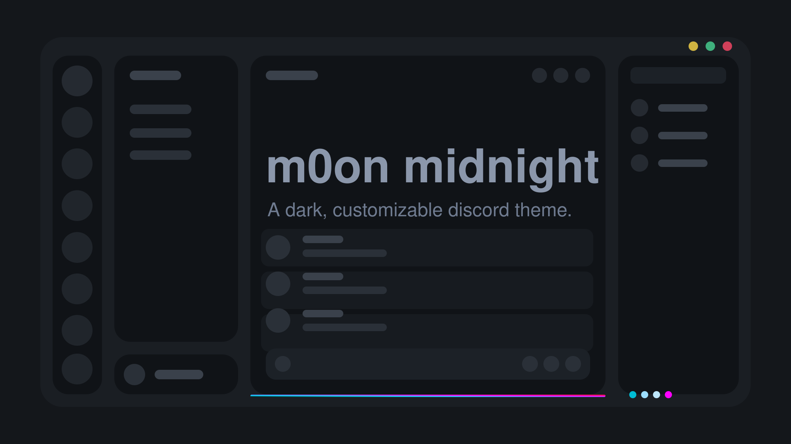
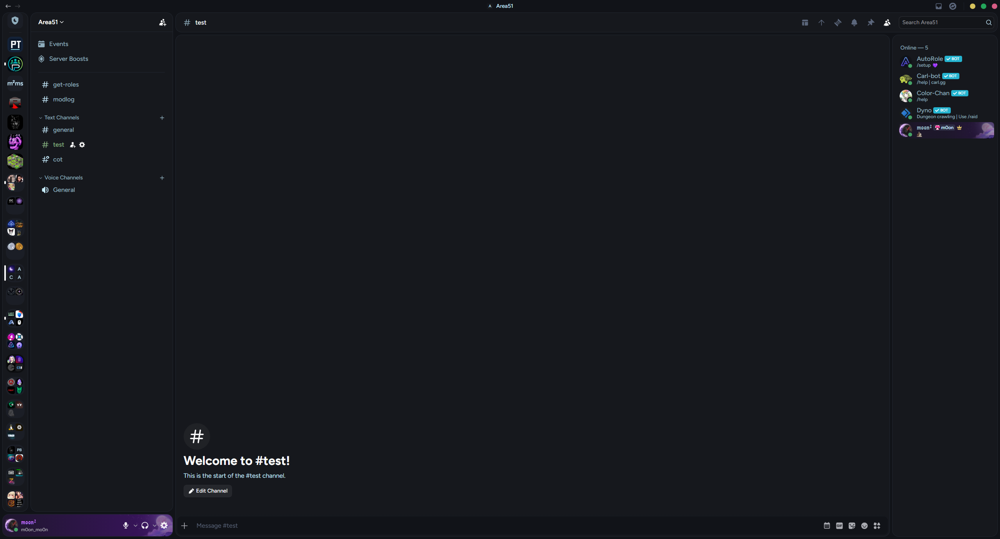
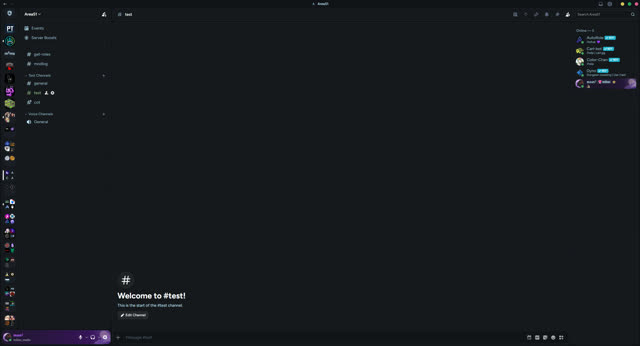
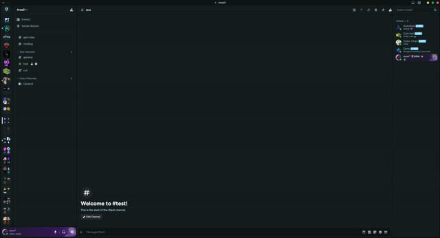
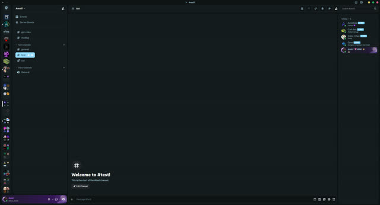
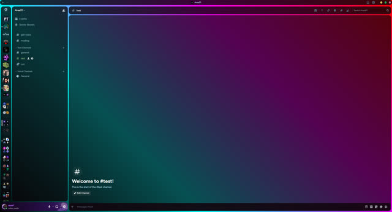

# m0on midnight

a dark, customizable discord theme with message cards, zelk colors and an optional horizontal server list.

> this repository ([M0on-Midnight](https://github.com/m0onmo0n/M0on-Midnight)) is the evolution of
> [zelk_moon](https://github.com/m0onmo0n/zelk_moon) and
> [Moon-midnight](https://github.com/m0onmo0n/Moon-midnight). it replaces both: the zelk look lives on as an
> optional palette and look here.

built on [midnight-discord](https://github.com/refact0r/midnight-discord) by refact0r




## install

### vencord/equicord/betterdiscord (or any client that supports theme files)

1. pick a flavor below and download its theme file from [`dist/`](dist/). (use the download button at the top right of the file page)
2. drag the file into your theme folder.
3. (optional) customize the theme by opening the file and editing the CSS variables within.

load **one** file at a time.

### install through link

add the link of your flavor to your theme import links (load one at a time):

| flavor | vertical server list | horizontal server list |
|---|---|---|
| midnight | `https://cdn.jsdelivr.net/gh/m0onmo0n/M0on-Midnight@main/dist/midnight.theme.css` | `https://cdn.jsdelivr.net/gh/m0onmo0n/M0on-Midnight@main/dist/midnight-hsl.theme.css` |
| zelk colors | `https://cdn.jsdelivr.net/gh/m0onmo0n/M0on-Midnight@main/dist/midnight-zelk-colors.theme.css` | `https://cdn.jsdelivr.net/gh/m0onmo0n/M0on-Midnight@main/dist/midnight-zelk-colors-hsl.theme.css` |
| zelk | `https://cdn.jsdelivr.net/gh/m0onmo0n/M0on-Midnight@main/dist/midnight-zelk.theme.css` | `https://cdn.jsdelivr.net/gh/m0onmo0n/M0on-Midnight@main/dist/midnight-zelk-hsl.theme.css` |
| cards | `https://cdn.jsdelivr.net/gh/m0onmo0n/M0on-Midnight@main/dist/midnight-cards.theme.css` | `https://cdn.jsdelivr.net/gh/m0onmo0n/M0on-Midnight@main/dist/midnight-cards-hsl.theme.css` |
| sky | `https://cdn.jsdelivr.net/gh/m0onmo0n/M0on-Midnight@main/dist/midnight-sky.theme.css` | (vertical only) |

- jsdelivr caches for a few hours, so updates can take a while to show up. to stay on a fixed version, replace `@main` with a commit or
  release tag (for example `@fed6760`).
- you will need to copy the theme variables to your quickcss in order to customize a linked theme.

## flavors

flavors are preset looks for the theme. every flavor comes in two layouts: the normal **vertical** server list and a
**horizontal** server list at the top (adds [Gibbu's Horizontal Server List](https://github.com/DiscordStyles/HorizontalServerList),
imported live so it keeps updating). the sky flavor only comes in the vertical layout.

click a layout link to open that theme file, or click a preview image to view the full screenshot.

<table>
    <tr>
        <td width="50%">
            <b>midnight</b><br>
            <a href="assets/flavors/midnight.png"></a><br>
            <a href="dist/midnight.theme.css">vertical</a> · <a href="dist/midnight-hsl.theme.css">horizontal</a><br>
            the original midnight palette.<br>
            <sub>previews: <a href="assets/flavors/midnight.png">vertical</a> · <a href="assets/flavors/midnight-hsl.png">horizontal</a> · <a href="assets/flavors/midnight-settings.png">settings</a></sub>
        </td>
        <td width="50%">
            <b>zelk colors</b><br>
            <a href="assets/flavors/zelk-colors.png"></a><br>
            <a href="dist/midnight-zelk-colors.theme.css">vertical</a> · <a href="dist/midnight-zelk-colors-hsl.theme.css">horizontal</a><br>
            only the zelk palette: zelk's blue-green hue with midnight's darker steps.<br>
            <sub>previews: <a href="assets/flavors/zelk-colors.png">vertical</a> · <a href="assets/flavors/zelk-colors-hsl.png">horizontal</a> · <a href="assets/flavors/zelk-colors-settings.png">settings</a></sub>
        </td>
    </tr>
    <tr>
        <td width="50%">
            <b>zelk</b><br>
            <a href="assets/flavors/zelk.png"></a><br>
            <a href="dist/midnight-zelk.theme.css">vertical</a> · <a href="dist/midnight-zelk-hsl.theme.css">horizontal</a><br>
            the palette plus zelk's 10px gaps, Inter font, rounded toolbar buttons, hidden scrollbars / profile notes / profile message box and the light-blue selected-channel pill.<br>
            <sub>previews: <a href="assets/flavors/zelk.png">vertical</a> · <a href="assets/flavors/zelk-hsl.png">horizontal</a> · <a href="assets/flavors/zelk-settings.png">settings</a></sub>
        </td>
        <td width="50%">
            <b>cards</b><br>
            <a href="assets/flavors/cards.png"></a><br>
            <a href="dist/midnight-cards.theme.css">vertical</a> · <a href="dist/midnight-cards-hsl.theme.css">horizontal</a><br>
            discord+-style message cards, a black / cyan / magenta / red gradient background, translucent plum panels and a <a href="https://github.com/Vendicated/Vencord/tree/main/src/plugins/betterFolders">BetterFolders</a> fix.<br>
            <sub>previews: <a href="assets/flavors/cards.png">vertical</a> · <a href="assets/flavors/cards-hsl.png">horizontal</a> · <a href="assets/flavors/cards-settings.png">settings</a></sub>
        </td>
    </tr>
    <tr>
        <td width="50%">
            <b>sky</b><br>
            <a href="dist/midnight-sky.theme.css">vertical</a> (no horizontal version)<br>
            the cards flavor with Sky Guy 1's colours and extras: darker panels, a different gradient, a red window frame, yellow ping accents, large chat avatars, hidden scrollbars and muted-channel colours. needs the normal (cozy) message layout, not compact.
        </td>
        <td width="50%"></td>
    </tr>
</table>

## options

everything is a variable in the theme file. a few useful ones:

| variable | what it does |
|---|---|
| `--small-avatars: on` | 28px avatars in Default (or Compact + "show avatars") message display |
| `--avatar-small` / `--avatar-small-left` | avatar size / left spacing |
| `--zelk-toolbar`, `--hide-scrollbars`, `--hide-profile-notes`, `--hide-profile-message-box` | zelk extras, off by default (on in the zelk flavor) |
| `--card-radius`, `--card-gap`, `--card-bg`, `--card-bg-hover`, `--chat-panel-opacity` | message card look (cards flavor) |
| `--HSL-server-direction`, `--HSL-server-alignment` | horizontal server list layout (horizontal files only) |

## server pill and ping colours

the theme colours unread and mentions: red = unread, yellow = ping (ping wins), green = the channel or server you have open. server
channels use Discord's own mention badge. the server list pills and the DM list need the **ServerPillColorizer** Vencord/Equicord
plugin, which stamps `data-server-unread` and `data-dm-ping` onto the elements. without the plugin those rules simply match nothing.
the plugin is not part of this repo. custom plugins need a source build of Equicord/Vencord (put the plugin in `src/userplugins/`).

## contributing

edit `src/midnight.theme.css` (or the files in `overlays/`), then rebuild the files in `dist/`:

```bash
python build.py
```

never edit files in `dist/` by hand; the next build overwrites them. needs only python 3.

```
src/midnight.theme.css      the full theme (source of truth)
overlays/zelk.css           zelk colour palette only
overlays/zelk-look.css      zelk gaps, extras and selected-channel pill
overlays/cards.css          message cards, gradient background, plum panels, betterfolders fix
overlays/cards-hsl.css      extra spacing for the cards flavor with the horizontal server list
overlays/sky.css            sky flavor: Sky Guy 1's colours and extras, on top of cards.css (vertical only)
build.py                    builds every flavor x layout into dist/
dist/                       generated themes (committed so they can be downloaded directly)
assets/                     preview screenshots (tools/make-thumbs.py makes the thumbnails)
```

### preview screenshots

`assets/preview.svg` is the banner. the flavor screenshots live in `assets/flavors/` (`<flavor>.png`, plus `<flavor>-hsl.png` and
`<flavor>-settings.png`). after adding or replacing a main screenshot, run `python tools/make-thumbs.py` to rebuild the thumbnails in
`assets/flavors/thumbs/` (needs [ffmpeg](https://ffmpeg.org/)).

## notes

- the theme imports a few external stylesheets (Google Fonts, the horizontal server list, Inter in the zelk flavor). Equicord/Vencord may
  warn about external imports; that is expected.
- rainbow VC avatars (rainbowglow-avatars) is commented out at the top of the source (the speaking ring uses the accent colour). to enable it,
  uncomment the jsDelivr import. an `@import` only works before any other rule, so all imports stay at the top (`build.py` keeps them there).

## license

MIT, see [LICENSE](LICENSE). third-party code and credits are listed in [NOTICE](NOTICE).

## credits

- [refact0r/midnight-discord](https://github.com/refact0r/midnight-discord): the base theme.
- [schnensch0/zelk](https://github.com/schnensch0/zelk): the original zelk theme the palette and look come from.
- Sky Guy 1: the sky flavor's colours and extras, and the original ServerPillColorizer and DmPingHighlighter plugins the ping
  colours are built on.
- [Gibbu / DiscordStyles](https://github.com/DiscordStyles/HorizontalServerList): horizontal server list.
- [MEWPASCO/rainbowglow-avatars](https://github.com/MEWPASCO/rainbowglow-avatars) and the
  "unread msg and selected channel snippet" by Amnissya: snippets bundled in the source.
